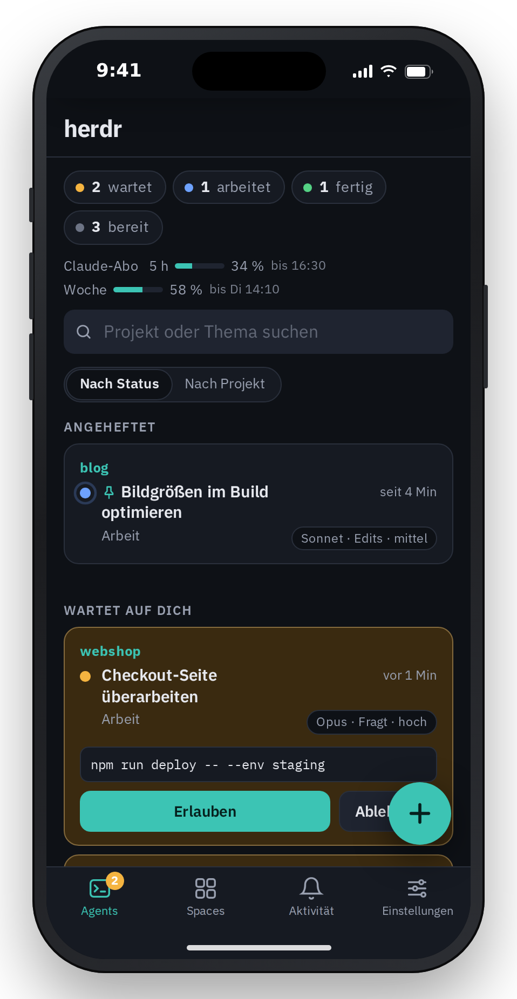
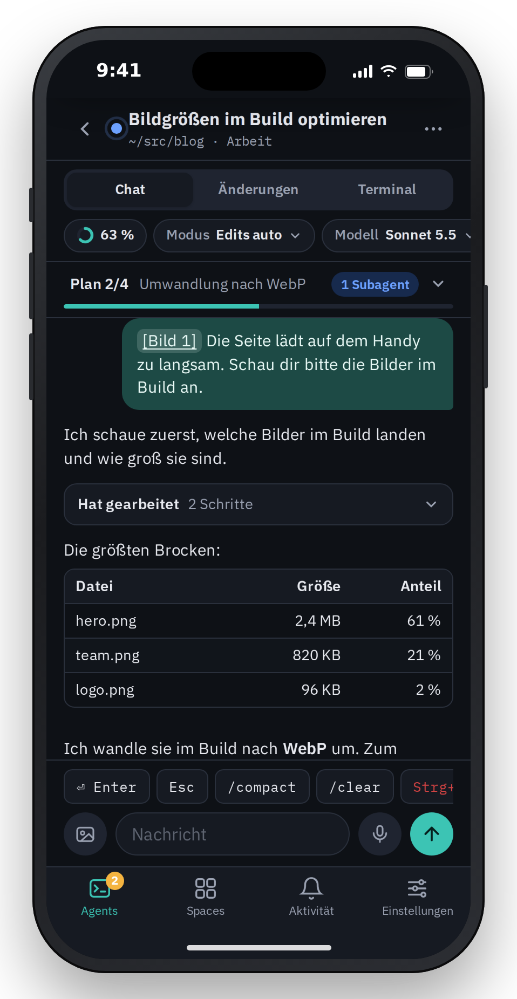
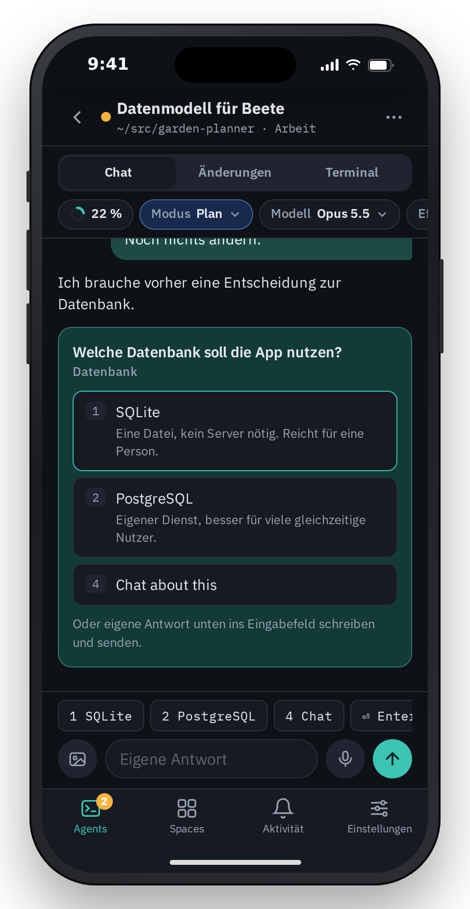
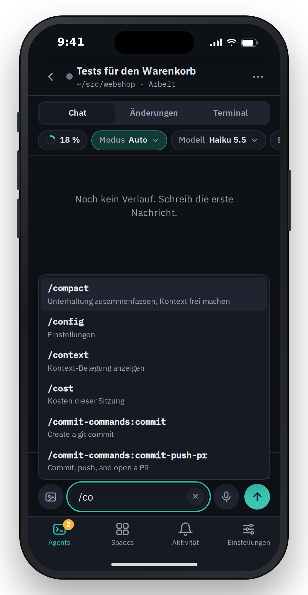
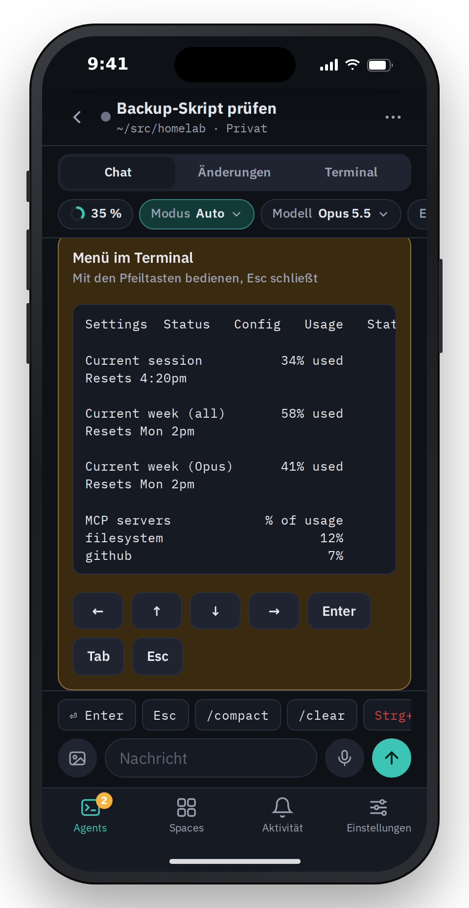
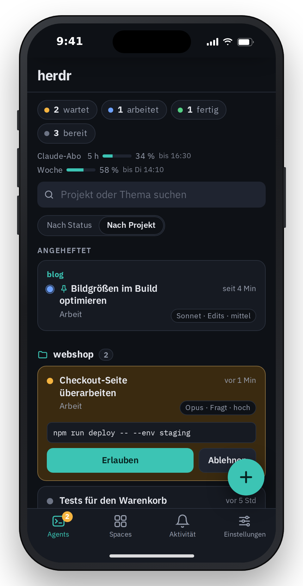
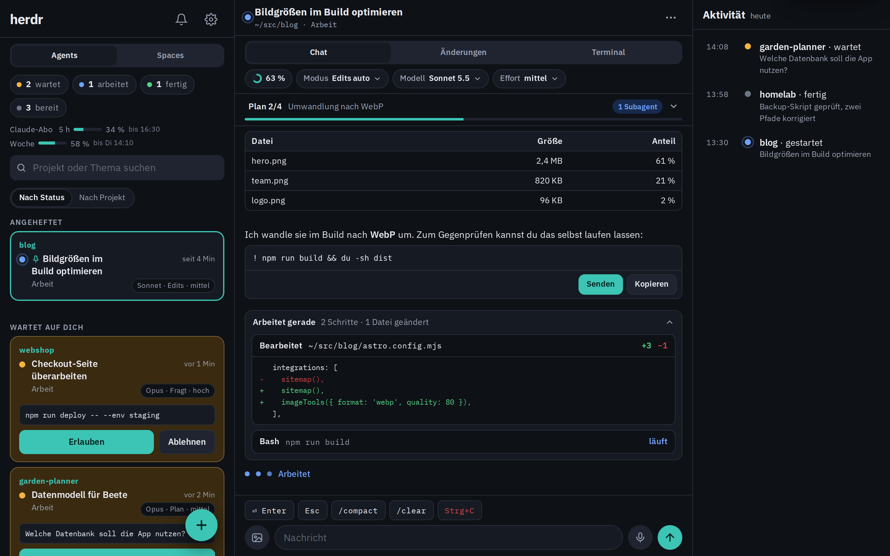
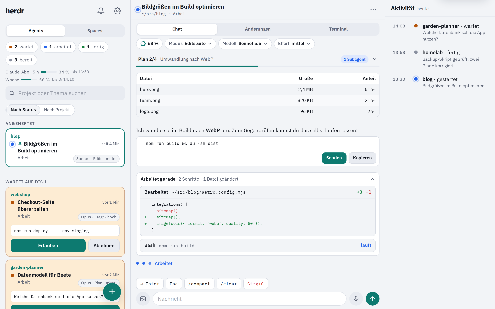

# herdr-pocket

**Your coding agents, in your pocket.** A phone-first web app (PWA) for [herdr](https://github.com/herdrdev/herdr): see every agent at a glance, approve tool calls, answer questions, read the chat and send prompts from your phone, or from a wide desktop layout.

> Unofficial companion app. Not affiliated with or endorsed by the herdr project. The UI is currently in **German**.

<p align="center">
  
  
  
</p>
<p align="center">
  
  
  
</p>



<details>
<summary>Light mode</summary>



</details>

## What it does

herdr-pocket is a small [Bun](https://bun.sh) server that talks to the herdr socket API on the same machine and serves a single-page app. Live updates go over a WebSocket.

**Agents**
- All agents across all herdr spaces, by status (waiting, working, done, ready) or grouped by project
- Sorted by the last real message, so the night's automatic restart does not reshuffle the list; new agents show up on top
- "Done" turns into "ready" once you open the chat, and this is stored on the server, so it counts on every device
- Pin agents to the top (also stored on the server)
- Start new agents: Claude Code, Codex or a local model via opencode, in an existing or new project and space
- Change mode, model and effort per Claude session; end agents, close shells and spaces with undo

**Approvals, questions and everything else that pops up in the terminal**
- Allow or deny Claude Code permission prompts straight from the list
- Multiple-choice questions (`AskUserQuestion`) as buttons, free-text answers, multi-part questions with the review/submit page
- "Trust this folder?" on the first start in a new folder, as a card with yes and no
- MCP sign-in (`/mcp`): a clean, tappable sign-in link instead of a wrapped terminal URL, and a field to paste the redirect address back
- Any other menu or full-screen view in the terminal (`/mcp`, `/model`, `/usage`, `/status`, `/config`, ...) shows up in the chat as a card you control with arrow keys, Enter, Tab and Esc
- If something in the terminal blocks input, sending is refused with a clear hint instead of typing into the menu; your text stays in the field
- Tips from the built-in "You should know" plugin with an expandable explanation and "discuss in chat", which only pre-fills your message

**Chat**
- Transcript view with tool calls, diffs, plan progress and subagents
- Auto-compaction shows up as a slim divider, the summary is collapsible
- Markdown tables, code blocks with copy buttons, one-tap "send" for `! command` lines, tap inline code to copy
- Slash command autocomplete: built-in commands, your own commands and skills, project commands and all enabled plugins
- Enter sends, Shift+Enter adds a line, arrow up/down in an empty field brings back your earlier messages
- Paste, drop or pick images (`Ctrl+V`), shown as `[Bild 1]`, deleted with a single backspace and viewable full-size later
- Links open in the real Safari when used as an iOS home-screen app
- Prompt queue while an agent is busy, quick keys (Enter, Esc, `/compact`, ...), a live terminal view

**Everything else**
- Claude subscription usage (5-hour and weekly limits) in the header, via a tiny status line script
- Web push notifications when an agent waits for you or is done, with quiet hours
- Activity timeline, swipe-back gesture, bottom sheets you can swipe away, dark and light theme

## Requirements

- A Linux machine running the [herdr](https://github.com/herdrdev/herdr) server (tested with herdr 0.9.5)
- [Bun](https://bun.sh) (tested with 1.4)
- Claude Code for the transcript, plan and usage features. Codex and opencode work through herdr's integrations (`herdr integration install codex|opencode`)
- `jq`, only for the optional usage status line

## Install

```sh
git clone https://github.com/essendyx/herdr-pocket.git ~/herdr-pocket
cd ~/herdr-pocket
bun install --frozen-lockfile
bun test
```

Try it locally without any login (binds to 127.0.0.1 only):

```sh
HERDR_APP_DEV=1 HOST=127.0.0.1 PORT=7683 bun server/main.ts
```

For real use, run it as a service. See [`examples/herdr-pocket.service`](examples/herdr-pocket.service).

## Configuration

| Variable | Default | Purpose |
|---|---|---|
| `HOST` | `127.0.0.1` | Address to bind to |
| `PORT` | `7683` | Port |
| `HERDR_APP_ORIGIN` | (required) | Public URL of the app, e.g. `https://herdr.example.com`. Used for CSRF and WebSocket origin checks |
| `CF_ACCESS_TEAM_DOMAIN` | | Cloudflare Access team domain, e.g. `myteam.cloudflareaccess.com` |
| `CF_ACCESS_AUD` / `CF_ACCESS_AUD_FILE` | | Application AUD tag, directly or from a file |
| `HERDR_APP_EMAIL` | | The one email address allowed in |
| `HERDR_APP_AUTH` | | Set to `none` to run without login (trusted networks only, see below) |
| `HERDR_APP_STATE` | `~/.config/herdr-app` | State: push keys, settings, pins, queue, usage |
| `HERDR_APP_IMAGE_DIR` | `$HERDR_APP_STATE/images` | Where pasted images are stored |
| `HERDR_SOCKET` | `~/.config/herdr/herdr.sock` | herdr API socket |
| `HERDR_APP_DEV` | | `1` = development mode: no login, only together with `HOST=127.0.0.1` |

## Security

This app can type into your terminals. Treat it like SSH access to the machine.

- The server **refuses to start** without authentication, unless you explicitly set `HERDR_APP_AUTH=none`.
- The recommended setup is a [Cloudflare Tunnel](https://developers.cloudflare.com/cloudflare-one/connections/connect-networks/) with a [Cloudflare Access](https://developers.cloudflare.com/cloudflare-one/applications/) application in front. The server verifies the Access JWT itself (signature, audience, issuer, email), so a misconfigured tunnel does not open it up.
- Writes need a matching `Origin` and a custom header (CSRF), the WebSocket checks the origin.
- Bind `HOST` to an address only your proxy or tunnel can reach, and firewall the port.
- `HERDR_APP_AUTH=none` is only for networks you fully trust (for example a VPN such as Tailscale or WireGuard).
- Only image files directly inside `HERDR_APP_IMAGE_DIR` are served back, nothing else.

## Subscription usage in the header (optional)

Claude Code passes `rate_limits` to its status line command. `bin/usage-statusline.sh` writes them to `$HERDR_APP_STATE/usage.json` and prints nothing. Add it to `~/.claude/settings.json`:

```json
{
  "statusLine": { "type": "command", "command": "sh ~/herdr-pocket/bin/usage-statusline.sh" }
}
```

## iPhone

Open the URL in Safari, then *Share → Add to Home Screen*. As a home-screen app it runs full screen, without zoom or sideways scrolling, and can receive push notifications (iOS 16.4+).

## Development

```sh
bun test            # server and UI tests (happy-dom)
HERDR_APP_DEV=1 HOST=127.0.0.1 PORT=7699 bun server/main.ts
```

No build step: `web/` is served as is. Server code is in `server/`, the UI in `web/app.js` and `web/app.css`.

The screenshots in this README are generated with made-up data, no server or herdr needed:

```sh
PLAYWRIGHT_CORE=/path/to/node_modules/playwright-core node scripts/screenshots.cjs
```

## License

[MIT](LICENSE)
